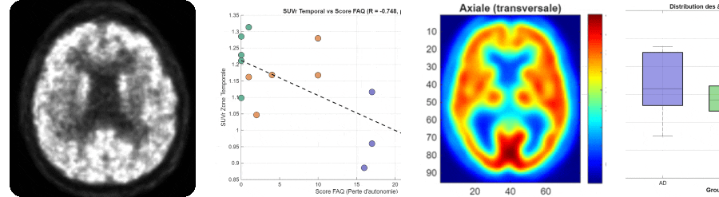
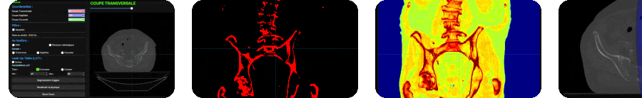
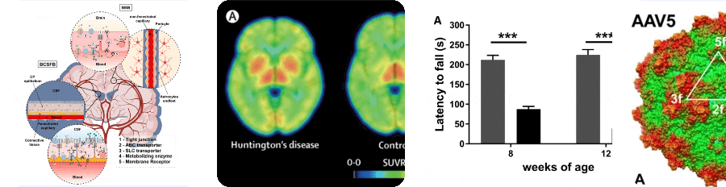
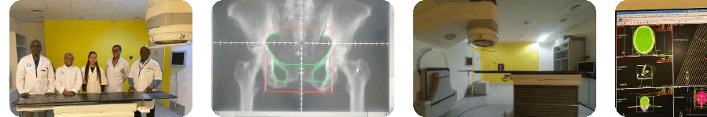

<h1 style="margin: 0 0 8px 0; font-size: 28px; color: #ffffff; border: none; font-weight: 700;">
Hegirziana Heva OBONE ESSONO
</h1>

M2 Radiophysique Médicale &bull; Université de Toulouse

Sommaire

<ul style="margin: 12px 0 4px 24px; padding: 0; list-style-type: disc; font-size: 14px; line-height: 1.6;">
<li style="margin-bottom: 4px;"><a href="#-à-propos" style="color: #ffcccc; text-decoration: underline;">Qui suis-je? (Mystère, mystère)</a></li>
<li style="margin-bottom: 4px;"><a href="#-à-propos" style="color: #ffcccc; text-decoration: underline;">Mon Mer-vei-lleux Parcours</a></li>
<li style="margin-bottom: 4px;"><a href="#-projets-académiques" style="color: #ffcccc; text-decoration: underline;">Mes Projets Académiques</a></li>
<li style="margin-bottom: 4px;"><a href="#-stages--expériences" style="color: #ffcccc; text-decoration: underline;"> Mes Stages & Expériences pro</a></li>
<li style="margin-bottom: 0;"><a href="#-compétences--technical-skills" style="color: #ffcccc; text-decoration: underline;">Mes Compétences</a></li>
</ul>

###  Qui suis-je? (Mystère, mystère)

<blockquote style="border-left: 4px solid #00599C; padding-left: 12px; margin-left: 0;">
  Bonjour, (ou bonsoir pour les oiseaux de nuit) et bienvenue sur ma "page"! Si vous êtes ici, c'est que vous souhaitez en savoir plus sur moi et mon parcours. Au moment où j'écris ce paragaphe, je suis en Master de Radiophysique Médicale, en recherche de stage, et préparant activement le Diplôme de Qualification en Physique Radiologique et Médicale (DQPRM). Je ne l'admettrai jamais à haute voix, mais une des raisons qui m'a poussée dans ce domaine est le pédigré monumental de l'intitulé du concours. (AVOUEZ que ça envoie). Mon domaine d'étude est une fierté pour moi, et bien qu'il ne soit pas toujours évident, je me réjouis de chaque réussite et de chaque notion apprise. Toute victoire (même les petites) compte, et je peux affirmer que sur ce chemin là, j'atteins les objectifs que je m'étais fixée plus jeune : "me lever chaque matin avec la conviction qu'en rentrant, j'aurai apporté mon savoir-faire et mon savoir-être pour guérir, soulager et améliorer le quotidien de mon prochain". Enfin bon, assez parlé de moi, n'hésitez pas (PAS DU TOUT) à scroller!!
</blockquote>

  

###  Projets académiques

<!-- PROJET 01 -->

  

  
  
  

  
<b>Détails du projet & Documents</b>

   

- **Cadre :** Projet de Master 1 — *Toulouse NeuroImaging Center (ToNIC)* (Mars 2026 – Mai 2026)
- **Rapport IEEE :** [`Projet Quantification TEP`](./Quantification_TEP_French_ver.pdf)
- **Présentation :** [`Support de présentation orale`](./Presentation_Quantification_TEP.pdf)

  

<blockquote style="border-left: 4px solid #008080; padding-left: 12px; margin-left: 0;">
  <strong>🎯 Sujet :</strong> Analyse TEP des biomarqueurs cérébraux et des déficits métaboliques régionaux dans la maladie d'Alzheimer.  
  <strong>Points clés :</strong>
  <ul>
    <li>Prétraitement de volumes cérébraux 3D sous <strong>SPM12</strong> (recalage spatial, normalisation MNI, interpolation trilinéaire).</li>
    <li>Calcul des métriques SUV et SUVR (zone de référence : cervelet).</li>
    <li>Analyse quantitative du métabolisme cérébral (cortex frontal, précunéus, cingulaire postérieur).</li>
  </ul>
</blockquote>

<a href="#sommaire--table-des-matières">↑ Retour au sommaire</a>

  

<!-- PROJET 02 -->

  

  
  
  
  

  
<b>Détails du projet & Documents</b>

   

- **Cadre :** Projet de Master 1 — *Faculté des Sciences et d'Ingénierie, Toulouse* (Fév 2026 – Mai 2026)
- **Présentation :** [`Présentation Projet C++`](./C++_Project_presentation.pdf)

  

<blockquote style="border-left: 4px solid #008080; padding-left: 12px; margin-left: 0;">
  <strong>Points clés :</strong>
  <ul>
    <li>Développement d'une interface interactive de visualisation 3D de données scanner DICOM en C++.</li>
    <li>Filtrage gaussien 2D par convolution, tables de correspondance (LUT / Palette Jet).</li>
    <li>Simulation de faisceau de radiothérapie, reconstruction de radiographies numériques (DRR) et segmentation anatomique temps réel.</li>
  </ul>
</blockquote>

<a href="#sommaire--table-des-matières">↑ Retour au sommaire</a>

  

<!-- PROJET 03 -->

  

  
  

  
<b>Détails du projet & Documents</b>

   

- **Cadre :** Projet de Licence — *Laboratoire SOFTMAT, Toulouse* (Sep 2024 – Jan 2025)
- **Rapport IEEE :** [`Projet Vectorisation`](./Vectorisation_ieee.pdf)
- **Présentation :** [`Support de présentation orale`](./Vectorisation_presentation.pdf)

  

<blockquote style="border-left: 4px solid #008080; padding-left: 12px; margin-left: 0;">
  <strong>Points clés :</strong>
  <ul>
    <li>Étude des stratégies de ciblage thérapeutique par vecteurs (AAV5/miRNA) franchissant la barrière hémato-encéphalique.</li>
    <li>Analyse de données précliniques sur la réduction de la protéine mHTT.</li>
  </ul>
</blockquote>

  

###  Stages & Expériences

<blockquote style="border-left: 4px solid #4B0082; padding-left: 12px; margin-left: 0;">
  <strong>📌 Expérience :</strong> Immersion de terrain en milieu clinique et en laboratoire de recherche.
</blockquote>

  
  
  
  

  

| Période | Poste | Structure | Missions clés |
| :--- | :--- | :--- | :--- |
| **Juin – Juil 2026** | 🏥 Stagiaire Physique Médicale | Institut de Cancérologie d'Akanda (ICA) | Assurance qualité LINAC, simulateur CT, calibrateur ISOMED · Contourage TPS (CTV, PTV) · Balistique de traitement |
| **Juin – Juil 2025** | 🧪 Stagiaire Recherche | Groupe PRHE — Laboratoire LAPLACE | Plasmas froids · Espèces réactives (ROS/RNS) · Décontamination biologique |

<a href="#-sommaire--table-of-contents">↑ Retour au sommaire</a>

  

  

